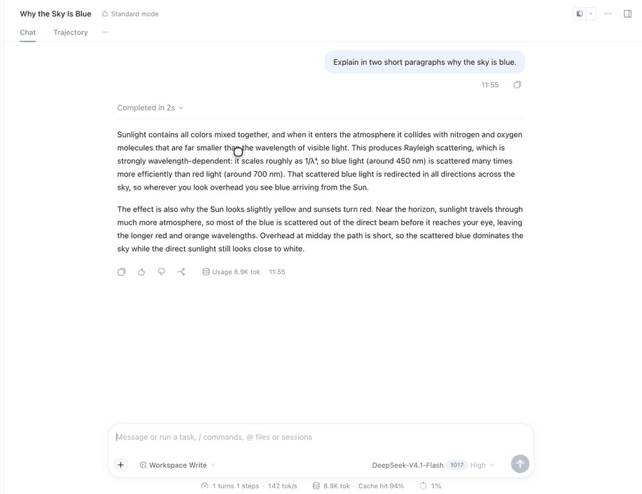

# dsh-quote-annotation

[](LICENSE)
[](https://github.com/topics/dsh-plugin)

Quote a passage from a DeepSeek Harness (DSH) conversation, attach an optional note, and send it with your next message as **structured reference context**. The quote never enters your draft and never shows up as raw JSON in Chat.

[中文](README.zh.md) · [Changelog](CHANGELOG.md) · [Maintainer notes](AGENTS.md)

## Demo



Select → **Add to chat** → optional note → send with the composer still empty. The reply keeps a `Note N` marker: hover to preview the quote, click to jump back to the source. The Chinese demo is [here](docs/media/quote-demo.gif); step-by-step stills live in [docs/media](docs/media).

## Features

- **Select → Add to chat.** A small action bar appears over the selection; the quote is stored immediately.
- **Optional annotation.** Add or edit a note at any time; `Enter` confirms, `Shift+Enter` inserts a newline.
- **Visible record.** A pill in the composer tool row shows what is pending; after sending, a pill above your message keeps it.
- **Quote-only messages.** The send button enables even when the composer is empty.
- **Inline markers.** Once the turn completes, an `注释 N` marker appears in the assistant reply at the paragraph that mentions the quote. Hover to preview, click to jump back to the source.
- **Survives restarts.** Sent records are rebuilt from the Session log, so pills and markers come back after a Host restart.
- **No editor mutation.** No Lexical chips, no hidden text, no zero-width characters left in the model prompt.
- **Zero dependencies, no build step.** A plain ESM host plugin and a single browser module.
- **Speaks your UI language.** Copy follows the DSH UI locale: Chinese and English ship with the plugin, and every other language falls back to English. Switching the language in Settings updates the pills, cards, markers and composer live, without a reload.

> UI copy is Chinese for a Chinese DSH UI (`添加到对话`, `N 条注释`, `注释 N`) and English otherwise (`Add to chat`, `N quotes`, `Note N`).

## How it works

```
selection ──► client ──► POST /dsh-quote-annotation/add
                              │
                              ▼
                       pending store (Host)
                              │
                    agent/pre-step (next user message)
                              │
                              ▼
        user message + hidden context message
        source.kind = "conversation-quote"
```

- The Host appends a hidden `user/message` after the direct user message. Chat hides ordinary context nodes, so the raw reference block never renders in the conversation.
- `source.references` carries the quote, the optional annotation, and source metadata (`nodeKey`, `anchorKey`, turn, kind).
- `GET /dsh-quote-annotation/sent` backfills sent records from the Session log, so historical quotes get pills after a Host restart.
- Quote-only sends use an invisible draft token (`U+2063`) to keep the native send button enabled. The Host strips it before the model step and falls back to `（引用）`.
- Sent pills sit above `[data-chat-flow-kind="user"][data-chat-turn=…]`; the React tree is never overridden.
- Inline markers are appended to the paragraph containing the quote (fallback: the last paragraph) and are idempotent per `turn:index`.

## Requirements

- DSH `0.2.x` with the Web client modules (DSH Desktop or `dsh web`), including
  `@deepseek-ai/dsh-client-locale` for the language switch.
- A profile you can modify (`web`, `desktop`, …).
- Node.js `>=22.19.0` for the Host.

## Install

From GitHub:

```sh
dsh plugin --profile web add github:stickyfinger7/dsh-quote-annotation
```

Pin a release:

```sh
dsh plugin --profile web add github:stickyfinger7/dsh-quote-annotation#v1.1.0
```

DSH Desktop installs into its own profile:

```sh
dsh plugin --profile desktop add github:stickyfinger7/dsh-quote-annotation
```

From a local checkout (useful while developing):

```sh
git clone https://github.com/stickyfinger7/dsh-quote-annotation.git
dsh plugin --profile web add ./dsh-quote-annotation
```

Restart the profile once — Host routes and `agent/pre-step` load at Host startup — then refresh an open page.

## Verify

1. Select text in Chat → **添加到对话**.
2. Optionally annotate; press `Enter`.
3. The composer tool row shows `N 条注释` and the send button is enabled.
4. Send without typing anything else.
5. A `N 条注释` pill appears above the user message; click it to jump to the source.
6. After the reply completes, `注释 N` appears in the assistant text; hover to preview.
7. Chat must not render `## Quoted conversation references`.

To disable the plugin without uninstalling, set `disabled: true` on the `quote-annotation` entry in the profile's `cordis.patch.yml`.

## Configuration

Defaults live in `cordis.patch.yml` and can be overridden in the profile patch under the `quote-annotation` entry:

| Option | Default | Meaning |
|---|---|---|
| `maxQuotes` | `8` | Pending quotes kept per session |
| `quoteMaxChars` | `8000` | Max characters per quoted passage |
| `annotationMaxChars` | `4000` | Max characters per annotation |
| `pendingTtlMs` | `86400000` | How long a pending quote stays alive |

## Compatibility

Tested with DSH `0.2.1-rc.3` (Web).

Client-side selectors:

- `[data-conversation-scroll]`
- `[data-chat-flow-kind="user"]`
- `[data-chat-turn]`
- `[data-chat-node-key]` / `[data-chat-anchor-key]`

Host-side contracts:

- `agent/pre-step` waterfall
- `ctx.sessions.get(id).snapshotEvents()` for historical backfill

It deliberately does **not** depend on `conversation.draftContexts`, native Lexical chips, or the reference pipeline.

## Limitations

- Pending quotes live in Host memory; a Host restart clears them. Sent records are backfilled from the log.
- Sent-pill placement and inline markers are DOM enhancements: a DSH Chat DOM change may require selector updates.
- Inline marker placement is a paragraph heuristic. If the assistant paraphrases instead of quoting, the marker lands at the end of the reply.
- There is no native Lexical chip — that is the price of never mutating the editor.
- UI copy covers Chinese and English only; other locales fall back to English. Host-side
  copy follows the language of the last mutation, so a stale tab can briefly disagree.

## Development

```sh
npm run check     # node --check on both sources
npm test          # node:test smoke tests
npx prettier@3 --write lib test
```

There is no install step: the plugin has no runtime or dev dependencies.

See [AGENTS.md](AGENTS.md) for the runtime model and the invariants to keep.

## License

[MIT](LICENSE)
