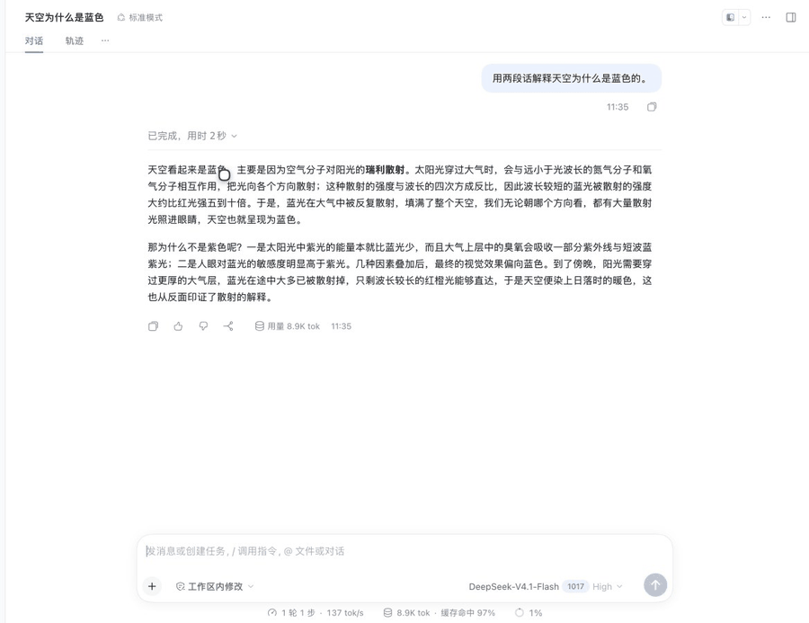

# dsh-quote-annotation

[](LICENSE)
[](https://github.com/topics/dsh-plugin)

在 DeepSeek Harness（DSH）对话里选中一段文字，可选加批注，然后作为**结构化引用上下文**随下一条消息发送。引用不会进入你的输入框，也不会在 Chat 里显示成原始 JSON。

[English](README.md) · [更新日志](CHANGELOG.md) · [Agent 说明](AGENTS.md)

## 演示



划词 → **添加到对话** → 可选批注 → 输入框空着也能发送。回复里保留 `注释 N`：悬停预览引用，点击跳回原文。英文版演示见 [这里](docs/media/quote-demo.en.gif)；分步截图见 [docs/media](docs/media)。

## 功能

- **选中 → 添加到对话**：选区上方出现操作条，点了就存下，没有多余弹窗。
- **批注可选**：随时补写或修改；`Enter` 确认，`Shift+Enter` 换行。
- **看得见但不打扰**：输入框工具行显示待发送胶囊；发送后用户消息上方保留胶囊。
- **可以只发引用**：输入框为空时发送键也能用。
- **行内标记**：回合结束后，助手回复中提到引用的段落末尾会出现 `注释 N`；悬停预览，点击跳回原文。
- **重启不丢**：发送记录从 Session 日志回填，Host 重启后胶囊和标记仍在。
- **不改编辑器**：不插 Lexical chip，不写隐藏文本，不把零宽字符留给模型。
- **零依赖、无构建**：Host 是普通 ESM，客户端是单个浏览器模块。
- **跟随界面语言**：文案跟着 DSH 的界面语言走，内置中文和英文；其他语言一律回退英语。在设置里切换语言，胶囊、卡片、行内标记和输入框立即跟着变，不用刷新。

> 中文界面显示 `添加到对话`、`N 条注释`、`注释 N`；其他界面显示 `Add to chat`、`N quotes`、`Note N`。

## 工作方式

```
选区 ──► 客户端 ──► POST /dsh-quote-annotation/add
                          │
                          ▼
                     Host 待引用表
                          │
                 agent/pre-step（下一条用户消息）
                          │
                          ▼
        用户消息 + 隐藏 context 消息
        source.kind = "conversation-quote"
```

- Host 在直接用户消息之后追加一条隐藏的 `user/message`。Chat 会隐藏普通 context 节点，所以原始引用块不会出现在对话里。
- `source.references` 保存引用、可选批注和来源元数据（`nodeKey`、`anchorKey`、turn、kind）。
- `GET /dsh-quote-annotation/sent` 从 Session 日志回填发送记录，Host 重启后历史引用也能显示胶囊。
- 只发引用时，用一个不可见草稿 token（`U+2063`）让原生发送键保持可用；Host 在模型步骤前剥离它，模型侧回落为 `（引用）`。
- 发送后的胶囊挂在 `[data-chat-flow-kind="user"][data-chat-turn=…]` 上方，不覆盖 React 渲染树。
- 行内标记追加到引用所在段落末尾（找不到就落到最后一段），按 `turn:index` 幂等更新。

## 环境要求

- DSH `0.2.x`，带 Web 客户端模块（DSH Desktop 或 `dsh web`），并包含
  `@deepseek-ai/dsh-client-locale`（语言切换）。
- 一个可以修改的 profile（`web`、`desktop` 等）。
- Host 侧 Node.js `>=22.19.0`。

## 安装

从 GitHub 安装：

```sh
dsh plugin --profile web add github:stickyfinger7/dsh-quote-annotation
```

固定到某个发布版本：

```sh
dsh plugin --profile web add github:stickyfinger7/dsh-quote-annotation#v1.1.0
```

DSH Desktop 装进它自己的 profile：

```sh
dsh plugin --profile desktop add github:stickyfinger7/dsh-quote-annotation
```

本地目录安装（开发时用）：

```sh
git clone https://github.com/stickyfinger7/dsh-quote-annotation.git
dsh plugin --profile web add ./dsh-quote-annotation
```

装完重启一次 profile（Host 路由和 `agent/pre-step` 在 Host 启动时加载），再刷新已打开的页面。

## 验证

1. 在 Chat 里选中文字 → **添加到对话**。
2. 可选填批注，按 `Enter`。
3. 输入框工具行显示 `N 条注释`，发送键可用。
4. 不用再输入别的，直接发送。
5. 用户消息上方出现 `N 条注释` 胶囊；点开可跳回原文。
6. 回复结束后，助手文本里出现 `注释 N`；悬停可预览。
7. Chat 里不应出现 `## Quoted conversation references`。

只想临时关掉插件而不卸载：在 profile 的 `cordis.patch.yml` 里给 `quote-annotation` 条目设 `disabled: true`。

## 配置

默认值写在 `cordis.patch.yml`，可以在 profile patch 的 `quote-annotation` 条目里覆盖：

| 选项 | 默认值 | 含义 |
|---|---|---|
| `maxQuotes` | `8` | 每个会话保留的待发送引用数 |
| `quoteMaxChars` | `8000` | 单条引用最大字符数 |
| `annotationMaxChars` | `4000` | 单条批注最大字符数 |
| `pendingTtlMs` | `86400000` | 待发送引用的存活时间 |

## 兼容性

已在 DSH `0.2.1-rc.3`（Web）上测试。

客户端依赖的选择器：

- `[data-conversation-scroll]`
- `[data-chat-flow-kind="user"]`
- `[data-chat-turn]`
- `[data-chat-node-key]` / `[data-chat-anchor-key]`

Host 侧契约：

- `agent/pre-step` waterfall
- `ctx.sessions.get(id).snapshotEvents()`（历史回填）

它刻意**不**依赖 `conversation.draftContexts`、原生 Lexical chip 或 reference pipeline。

## 限制

- 待发送引用只存在 Host 内存里，Host 重启即清空；发送记录会从日志回填。
- 发送胶囊和行内标记都是 DOM 增强：DSH Chat DOM 变化时可能需要更新选择器。
- 行内标记是段落级启发式。助手转述而不是提到原文时，标记会落在回复末尾。
- 没有原生 Lexical chip——这是"绝不改编辑器"的代价。
- 界面文案只有中文和英文两套，其他语言回退英语。Host 侧文案跟随最近一次请求的语言。

## 开发

```sh
npm run check     # 检查两个源文件的语法
npm test          # node:test 冒烟测试
npx prettier@3 --write lib test
```

无需安装依赖：插件没有运行时依赖，也没有开发依赖。

运行时模型和必须守住的约束见 [AGENTS.md](AGENTS.md)。

## 许可证

[MIT](LICENSE)
